# Star Tracker Report

**2026-10-12** | Total: **949 stars** | Change: **+1**

> Compared to snapshot from 2026-10-11

## 📈 Star Trend

### By Repository

Individual Repository Charts

#### saucer/saucer

## Repositories

| Repositories | Stars | Change | Trend |
|:-----------|------:|-------:|:-----:|
| [saucer/saucer](https://github.com/saucer/saucer) | 949 | +1 | ⬆️ |

## Summary

- **Stars gained:** 1
- **Stars lost:** 0
- **Net change:** +1

## 🔮 Growth Forecast

**Aggregate Forecast**

| Method | Week 1 | Week 2 | Week 3 | Week 4 |
|:---|---:|---:|---:|---:|
| Linear Regression | 953 | 957 | 961 | 965 |
| Weighted Moving Average | 954 | 960 | 965 | 970 |

### By Repository

saucer/saucer

**saucer/saucer**

| Method | Week 1 | Week 2 | Week 3 | Week 4 |
|:---|---:|---:|---:|---:|
| Linear Regression | 953 | 957 | 961 | 965 |
| Weighted Moving Average | 954 | 960 | 965 | 970 |

---
*Generated by [GitHub Star Tracker](https://github.com/fbuireu/github-star-tracker) on 2026-10-12T02:44:15.764Z*

*Made with 🤘 by [Ferran Buireu](https://github.com/fbuireu)*

