# Star Tracker Report

**2026-11-23** | Total: **969 stars** | Change: **0**

> Compared to snapshot from 2026-11-22

## 📈 Star Trend

### By Repository

Individual Repository Charts

#### saucer/saucer

## Repositories

| Repositories | Stars | Change | Trend |
|:-----------|------:|-------:|:-----:|
| [saucer/saucer](https://github.com/saucer/saucer) | 969 | 0 | ➖ |

## 🔮 Growth Forecast

**Aggregate Forecast**

| Method | Week 1 | Week 2 | Week 3 | Week 4 |
|:---|---:|---:|---:|---:|
| Linear Regression | 973 | 977 | 981 | 986 |
| Weighted Moving Average | 974 | 980 | 985 | 990 |

### By Repository

saucer/saucer

**saucer/saucer**

| Method | Week 1 | Week 2 | Week 3 | Week 4 |
|:---|---:|---:|---:|---:|
| Linear Regression | 973 | 977 | 981 | 986 |
| Weighted Moving Average | 974 | 980 | 985 | 990 |

---
*Generated by [GitHub Star Tracker](https://github.com/fbuireu/github-star-tracker) on 2026-11-23T04:09:36.346Z*

*Made with 🤘 by [Ferran Buireu](https://github.com/fbuireu)*

